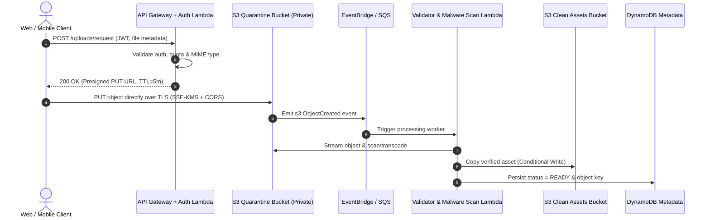
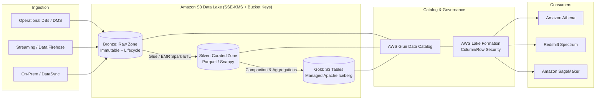
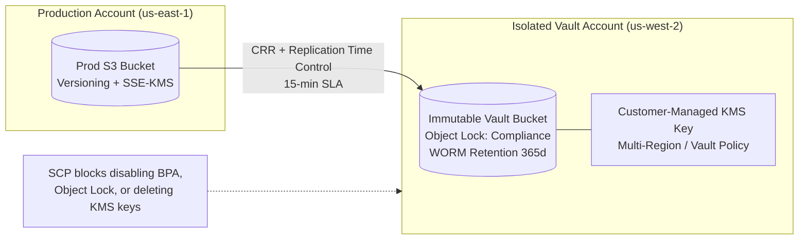

# AWS S3 — Complete Guide (Basics → Enterprise → Interview)

> Comprehensive reference covering fundamentals, storage classes, security, data management, performance, FinOps, architecture diagrams, end-to-end CLI practical labs, and senior interview Q&A.
> *Note: AWS evolves S3 quotas and features regularly. Core architectural principles below are stable; always verify regional pricing and newly launched service limits against official AWS documentation before quoting exact numbers.*

---

## Table of Contents
1. What is S3?
2. Core Concepts
3. Consistency, Durability, Availability (Design vs. SLA)
4. Storage Classes
5. Security (The Most Asked Area)
6. Versioning, Object Lock, MFA Delete
7. Lifecycle Management
8. Replication (CRR / SRR & Batch Replication)
9. Performance Optimization
10. Event Notifications & Integrations
11. Data Management, FinOps & Observability
12. Static Website Hosting, CORS & CloudFront
13. Access Points & Multi-Region Access Points
14. Newer S3 Offerings
15. Pricing Model & Cost Optimization
16. Limits & Quotas to Remember
17. Enterprise Architecture Patterns & Diagrams
18. Industry Use Cases
19. Common Mistakes & Real-World Lessons
20. Complete Hands-on Practical Labs (All AWS CLI Commands)
21. Interview Questions & Answers (50+ Scenarios)
22. One-Page Cheat Sheet
23. Suggested Session Flow

---

## 1. What is S3?

**Amazon Simple Storage Service (S3)** is a fully managed **object storage** service with virtually unlimited capacity, accessed over HTTPS via REST API, SDKs, CLI, or the AWS Management Console.

### Storage Types: Block vs. File vs. Object

| Type | AWS Service | Access Protocol | Best For |
|---|---|---|---|
| **Block** | Amazon EBS | Block device attached to EC2 | OS boot volumes, transactional databases, low-latency random I/O |
| **File** | Amazon EFS / FSx | NFS / SMB mount, shared POSIX | Shared file systems, lift-and-shift enterprise apps, home directories |
| **Object** | **Amazon S3** | HTTPS REST API (`key → object`) | Unstructured data, backups, data lakes, media, logs, AI/ML datasets |

### Key Characteristics
- **Flat namespace**: There are no real folders. "Folders" are simply key prefixes (`logs/2026/11/app.log`) rendered visually by consoles and tools using a delimiter (`/`).
- **Immutable object model**: S3 is not a POSIX file system or database—there is no byte-level append, in-place partial edit, or file locking. Updating an object replaces the entire object (or creates a new version).
- **Regional storage, global bucket namespace**: Data stays strictly inside the AWS Region where you create the bucket unless you explicitly replicate it. General-purpose bucket names are globally unique across all AWS accounts.
- **Serverless & elastic**: Zero capacity provisioning, automatic scaling, and pay-as-you-go billing.

---

## 2. Core Concepts

### Bucket
- Logical container for objects. General-purpose bucket names must be **3–63 characters**, lowercase, DNS-compliant, and globally unique across all AWS accounts and partitions.
- **Quotas**: Default quota is **10,000 general-purpose buckets** per account (older documentation cites 100), adjustable up to **1,000,000 buckets**.
- **Bucket-level configurations**: Bucket policies, encryption defaults, versioning, lifecycle rules, replication, access logging, event notifications, CORS, and tags.

### Object
- Comprises: **Key** (name), **Value** (binary payload), **Version ID**, **Metadata** (system metadata + user-defined `x-amz-meta-*` up to 2 KB), **Object Tags** (up to 10 key-value pairs per object), and **Subresources** (e.g., ACLs, legal hold, retention).
- **Object Size Limits**:
  - Single `PUT` upload: up to **5 GB**.
  - Multipart Upload: parts must be **5 MiB to 5 GiB** (up to **10,000 parts**), except the **last part**, which has **no minimum size limit**.
  - Maximum object size: **5 TB** standard reference (with expanded support up to **50 TB** in newer S3 multipart/SDK capabilities—verify workload/client limits).
  - Recommended threshold for Multipart Upload: **> 100 MB**.
- **Key length**: Up to **1,024 bytes** UTF-8.

### Key, Prefix, and Delimiter
- **Key**: Full object identifier (e.g., `raw/events/year=2026/month=11/part-001.parquet`).
- **Prefix**: Leading substring of a key (`raw/events/`).
- **Delimiter**: Character (typically `/`) used by `ListObjectsV2` to group keys into `CommonPrefixes` (simulated folders).

### Bucket Types
1. **General Purpose Buckets**: Classic S3 buckets for general storage, analytics, and multi-AZ durability.
2. **Directory Buckets**: Used by **S3 Express One Zone**; stores data in a single AZ with hierarchical directory semantics for single-digit millisecond latency.
3. **Table Buckets**: Purpose-built for **S3 Tables** (managed Apache Iceberg tables with automated compaction and snapshot maintenance).

### Addressing Styles
- **Virtual-hosted style (standard)**: `https://<bucket-name>.s3.<region>.amazonaws.com/<key>`
- **Path style (deprecated/legacy)**: `https://s3.<region>.amazonaws.com/<bucket-name>/<key>`

### Multipart Upload (MPU)
- Splits large files into independent parts uploaded in parallel. Supports pause/resume and retrying individual failed parts without restarting the entire upload.
- **Critical FinOps Gotcha**: Incomplete multipart uploads still consume and bill for storage until completed or aborted. Always attach a lifecycle rule with `AbortIncompleteMultipartUpload` (e.g., after 7 days).

### Checksums & Data Integrity
- S3 supports end-to-end checksum verification using **CRC32, CRC32C, SHA-1, SHA-256, and CRC64NVME**. Modern AWS SDKs compute and validate checksums automatically.
- **Do not rely on `ETag` as an MD5 hash**: `ETag` is only a plain MD5 digest for single-part uploads encrypted with SSE-S3 or unencrypted. Multipart uploads and SSE-KMS objects produce non-MD5 ETags.

### Conditional Operations (Optimistic Concurrency)
- **Conditional Writes** (`If-None-Match: *` or `If-Match: <ETag>`): Enables atomic "create only if key does not exist" and "update only if object hasn't changed" semantics—eliminating external locking for distributed writers.
- **Conditional Reads** (`If-Match`, `If-None-Match`, `If-Modified-Since`, `If-Unmodified-Since`): Avoids downloading unchanged objects.

---

## 3. Consistency, Durability, Availability (Design vs. SLA)

### Consistency Model
- Since **December 2020**, Amazon S3 provides **strong read-after-write consistency** for all `PUT` (new and overwrite), `DELETE`, and `LIST` operations across all Regions at no extra cost.
- **Classic Interview Trap**: Claiming S3 has "eventual consistency for overwrite PUTs and DELETEs" is **outdated**.
- **Nuance**: Strong consistency applies per object key. S3 does not provide multi-object ACID transactions natively (use **S3 Tables / Apache Iceberg** for transactional table mutations) or distributed locks (use **Conditional Writes**).

### Durability
- **99.999999999% (11 nines)** designed annual durability across all multi-AZ storage classes (and even single-AZ classes protect against disk/rack failures within that AZ via erasure coding and checksums).
- **Durability $\neq$ Accidental Deletion Protection**: 11 nines protects against hardware/facility failure, **not** `rm -rf` or compromised credentials. Combine S3 with **Versioning, Object Lock, and Cross-Account Replication**.

### Design Availability vs. Monthly Uptime SLA
Interviewers frequently test whether you know the difference between **design availability** (architecture target) and **Monthly Uptime Percentage SLA** (service credit threshold):

| Storage Class | AZ Redundancy | Design Availability | Monthly Uptime SLA |
|---|---|---|---|
| **S3 Standard** | $\ge 3$ AZs | 99.99% | 99.9% |
| **S3 Intelligent-Tiering** | $\ge 3$ AZs | 99.9% | 99.0% |
| **S3 Standard-IA** | $\ge 3$ AZs | 99.9% | 99.0% |
| **S3 One Zone-IA** | 1 AZ | 99.5% | 99.0% |
| **S3 Glacier Instant Retrieval** | $\ge 3$ AZs | 99.9% | 99.0% |
| **S3 Glacier Flexible Retrieval** | $\ge 3$ AZs | 99.99% *(after restore)* | 99.9% |
| **S3 Glacier Deep Archive** | $\ge 3$ AZs | 99.99% *(after restore)* | 99.9% |
| **S3 Express One Zone** | 1 AZ | 99.95% | 99.9% |

---

## 4. Storage Classes

| Class | Best Use Case | AZs | Min Duration | Min Billable Object Size | Retrieval Fee | First-Byte Latency |
|---|---|---|---|---|---|---|
| **S3 Standard** | Hot, frequently accessed active data | $\ge 3$ | None | None | None | Milliseconds |
| **S3 Intelligent-Tiering** | Unpredictable or changing access patterns | $\ge 3$ | None | Objects < 128 KB stay in Frequent Access | None *(per-object monitoring fee)* | Milliseconds *(for non-async tiers)* |
| **S3 Standard-IA** | Infrequent access requiring instant reads (DR, backups) | $\ge 3$ | 30 days | 128 KB | Per GB | Milliseconds |
| **S3 One Zone-IA** | Secondary/re-creatable infrequent backups (~20% cheaper) | **1** | 30 days | 128 KB | Per GB | Milliseconds |
| **S3 Glacier Instant Retrieval** | Archive accessed ~1x/quarter needing ms latency (medical images) | $\ge 3$ | 90 days | 128 KB | Per GB | Milliseconds |
| **S3 Glacier Flexible Retrieval** | Cold archives where minutes-to-hours restore is acceptable | $\ge 3$ | 90 days | None *(40 KB metadata overhead)* | Per GB + per request | Expedited: 1–5 min<br>Standard: 3–5 hrs<br>Bulk: 5–12 hrs |
| **S3 Glacier Deep Archive** | Cheapest storage; 7–10+ yr regulatory/compliance archives | $\ge 3$ | 180 days | None *(40 KB metadata overhead)* | Per GB + per request | **No Expedited tier**<br>Standard: ~12 hrs<br>Bulk: ~48 hrs |
| **S3 Express One Zone** | Ultra-low latency, high-TPS compute (ML training, interactive analytics) | **1** *(chosen AZ)* | 1 hour | None | None *(request-based)* | Single-digit ms |
| **S3 on Outposts** | On-premises data residency / local processing | Outposts | — | — | — | Local LAN ms |

### S3 Intelligent-Tiering Mechanics
Automatically moves objects between access tiers with **zero retrieval fees** and **zero tier-transition fees**:
- **Frequent Access** (default on upload)
- **Infrequent Access** (after 30 consecutive days of no access)
- **Archive Instant Access** (after 90 consecutive days of no access; still millisecond latency)
- **Opt-in Asynchronous Tiers**: *Archive Access* (configurable 90–730+ days) and *Deep Archive Access* (configurable 180–730+ days), which require asynchronous restore before reading.
- **Note**: Objects smaller than **128 KB** are never transitioned out of Frequent Access and incur **no monitoring fee**.

### Glacier Restore Behavior
- Restoring from **Glacier Flexible Retrieval** or **Glacier Deep Archive** does **not** change the object's underlying storage class; it creates a **temporary restored copy** in S3 Standard for the retention window (`Days`) you specify in `RestoreObject`.

---

## 5. Security (The Most Asked Area)

### 5.1 Shared Responsibility Model
- **AWS**: Physical data center security, hardware lifecycle, network isolation, underlying storage durability/availability.
- **Customer**: Bucket/IAM policies, Block Public Access configuration, encryption settings, KMS key policies, data classification, and access auditing.

### 5.2 Secure Defaults on New Buckets
- **Block Public Access (BPA)**: Enabled by default on all new buckets.
- **ACLs Disabled**: `Object Ownership = Bucket owner enforced` by default.
- **Default Encryption**: `SSE-S3` (AES-256) automatically encrypts every new object at rest.

### 5.3 Policy Evaluation Logic
1. **Explicit `Deny` ALWAYS wins** across *all* policy layers (SCPs, RCPs, VPC Endpoint policies, Bucket policies, Access Point policies, IAM policies, and Session policies).
2. **Same-Account Access**: Requires an explicit `Allow` in **either** the IAM identity policy **or** the S3 bucket policy (with no explicit `Deny`).
3. **Cross-Account Access**: Requires an explicit `Allow` in **both** the caller's IAM policy (in Account A) **and** the bucket/KMS key policy (in Account B).
4. **Default**: Implicit `Deny`.

### 5.4 Defense-in-Depth Control Layers
1. **AWS Organizations SCPs & Resource Control Policies (RCPs)**: Org-wide guardrails (e.g., deny `s3:PutBucketPublicAccessBlock` modifications or deny access from principals outside `aws:PrincipalOrgID`).
2. **Block Public Access (Account + Bucket level)**: Overrides any public ACL or public bucket policy.
3. **Bucket Policies** (capped at **20 KB**): Resource-based JSON policies supporting conditions, cross-account principals, and VPC endpoint restrictions.
4. **IAM Policies**: Identity-based permissions attached to roles/users.
5. **S3 Access Points**: Scoped entry points with dedicated policies per team/application.
6. **VPC Endpoint Policies**: Restrict which buckets/accounts can be accessed over private VPC paths.
7. **Presigned URLs / Presigned POST**: Time-bound cryptographic delegation without AWS credentials.

### 5.5 Production Bucket Policy Examples

**Enforce TLS (HTTPS) Only:**
```json
{
  "Version": "2012-10-17",
  "Statement": [
    {
      "Sid": "DenyInsecureTransport",
      "Effect": "Deny",
      "Principal": "*",
      "Action": "s3:*",
      "Resource": [
        "arn:aws:s3:::prod-corp-data",
        "arn:aws:s3:::prod-corp-data/*"
      ],
      "Condition": {
        "Bool": { "aws:SecureTransport": "false" }
      }
    }
  ]
}
```

**Restrict Access Strictly to a VPC Endpoint & AWS Organization:**
```json
{
  "Version": "2012-10-17",
  "Statement": [
    {
      "Sid": "EnforcePrivateVPCEAndOrg",
      "Effect": "Deny",
      "Principal": "*",
      "Action": "s3:*",
      "Resource": [
        "arn:aws:s3:::prod-corp-data",
        "arn:aws:s3:::prod-corp-data/*"
      ],
      "Condition": {
        "StringNotEquals": {
          "aws:SourceVpce": "vpce-0123456789abcdef0",
          "aws:PrincipalOrgID": "o-xxxxxxxxxx"
        }
      }
    }
  ]
}
```

**Enforce SSE-KMS Encryption on Upload:**
```json
{
  "Version": "2012-10-17",
  "Statement": [
    {
      "Sid": "DenyUnencryptedOrNonKMSUploads",
      "Effect": "Deny",
      "Principal": "*",
      "Action": "s3:PutObject",
      "Resource": "arn:aws:s3:::prod-corp-data/*",
      "Condition": {
        "StringNotEquals": {
          "s3:x-amz-server-side-encryption": "aws:kms"
        }
      }
    }
  ]
}
```

### 5.6 Encryption Options

| Mechanism | Key Management | Key Features & Trade-offs |
|---|---|---|
| **SSE-S3** | AWS S3 manages keys (AES-256) | Default, zero cost, zero throttling risk, no KMS CloudTrail audit trail |
| **SSE-KMS** | AWS KMS (AWS-managed or Customer-Managed Key) | Full CloudTrail audit logs, key rotation, separate key policy control. **Subject to KMS API quotas & costs**—enable **S3 Bucket Keys** to cut KMS API calls/costs by up to ~99% |
| **DSSE-KMS** | AWS KMS (Dual-layer encryption) | Applies two independent layers of encryption for high-assurance compliance |
| **SSE-C** | Customer passes key on every HTTP request | AWS never persists the key; losing your key means permanent data loss |
| **Client-Side** | Encrypted before leaving client (AWS Encryption SDK) | End-to-end zero-trust; AWS never sees plaintext or encryption keys |

### 5.7 Network Security: Gateway vs. Interface VPC Endpoints

| Feature | Gateway VPC Endpoint | Interface VPC Endpoint (PrivateLink) |
|---|---|---|
| **Mechanism** | Prefix list entry in VPC Route Tables | Elastic Network Interfaces (ENIs) with private IPs |
| **Cost** | **Free** (no hourly or per-GB endpoint fee) | Hourly ENI charge + per-GB data processing fee |
| **On-Prem / Peered Reachability** | **No** (VPC-local only) | **Yes** (reachable over Direct Connect, VPN, Transit Gateway) |
| **Primary Win** | Eliminates expensive **NAT Gateway** data charges for EC2/ECS/Lambda in private subnets | Hybrid on-prem private connectivity to S3 without traversing the public internet |

### 5.8 Auditing, Threat Detection & Compliance
- **CloudTrail Data Events**: Object-level `GetObject`, `PutObject`, `DeleteObject` logs (opt-in, paid; near real-time).
- **S3 Server Access Logs**: Low-cost, best-effort delivery of raw HTTP access logs to a target bucket (delayed delivery; **never log into the same bucket** or you will trigger an infinite log-amplification loop!).
- **Amazon Macie**: Automated ML discovery and classification of PII, PHI, and credentials in S3.
- **Amazon GuardDuty S3 Protection**: Detects anomalous S3 API calls, Tor access, and credential exfiltration patterns.
- **IAM Access Analyzer for S3**: Continuously flags buckets shared publicly or outside your AWS Organization.
- **Compliance**: Supports HIPAA, PCI DSS, SOC 1/2/3, ISO 27001, FedRAMP, GDPR, and **SEC 17a-4(f) / FINRA / CFTC** (via Object Lock Compliance mode).

---

## 6. Versioning, Object Lock, MFA Delete

### Versioning
- Bucket-level setting with three states: **Unversioned (default) $\rightarrow$ Enabled $\rightarrow$ Suspended** (once enabled, it can never return to Unversioned).
- Overwriting a key creates a new `VersionId`; all versions remain stored and billed.
- Deleting an object *without* specifying a `VersionId` inserts a **Delete Marker** (hides the object from standard `GET` requests while preserving older versions).
- Permanent deletion requires calling `DeleteObject` with the explicit `VersionId`.

### Object Lock (WORM — Write-Once-Read-Many)
- Protects specific **object versions** against deletion or modification. Can be enabled on new or existing versioned buckets.
- **Governance Mode**: Users with `s3:BypassGovernanceRetention` can override retention settings (ideal for testing or controlled operational overrides).
- **Compliance Mode**: **No user—not even the AWS account root user—can delete or shorten the retention period** until it expires.
- **Legal Hold**: Boolean on/off lock independent of retention dates; controlled via `s3:PutObjectLegalHold`.
- **Production Gotcha**: Even with Object Lock enabled, a standard `DELETE` (without `VersionId`) still places a **Delete Marker** so the object appears deleted in normal listings, though the underlying locked version remains immutable and recoverable.

### MFA Delete
- Requires a hardware/virtual MFA token to change bucket versioning state or permanently delete a versioned object.
- Can **only** be enabled by the **AWS account root user** via CLI/API. Largely superseded in modern enterprises by **Object Lock + SCPs**.

---

## 7. Lifecycle Management

Automates object transitions and expirations based on prefix, object tags, or object size filters.

### Typical Enterprise Progression
```text
Day 0    → S3 Standard
Day 30   → S3 Standard-IA (or Intelligent-Tiering from Day 0)
Day 90   → S3 Glacier Instant Retrieval / Flexible Retrieval
Day 365  → S3 Glacier Deep Archive
Day 2555 → Expire (7-year compliance retention complete)
```

### Critical Lifecycle Rules & Gotchas
1. **30-day minimum age**: Objects cannot transition from `Standard` to `Standard-IA` or `One Zone-IA` until they are at least 30 days old.
2. **Minimum storage duration penalty**: Deleting or transitioning an object before its class minimum (30 days for IA, 90 days for Glacier IR/Flexible, 180 days for Deep Archive) incurs pro-rated early-deletion charges.
3. **Small-object trap**: Never transition objects **< 128 KB** to IA or Glacier Instant Retrieval—they are billed at the 128 KB minimum, increasing storage costs while adding per-object transition fees. Always include `ObjectSizeGreaterThan: 131072`.
4. **Cleanup noncurrent versions & delete markers**: Always pair versioning with `NoncurrentVersionTransition`, `NoncurrentVersionExpiration`, and `ExpiredObjectDeleteMarker` cleanup.
5. **Asynchronous execution**: Lifecycle rules run asynchronously once per day (around midnight UTC), not at the exact second an object hits $N$ days.

---

## 8. Replication (CRR / SRR & Batch Replication)

| Type | Scope | Common Enterprise Drivers |
|---|---|---|
| **CRR** (Cross-Region Replication) | Different AWS Regions | Disaster recovery (RPO/RTO), geographic compliance, lower read latency for global users |
| **SRR** (Same-Region Replication) | Same AWS Region | Centralizing logs across accounts, replicating prod data to isolated dev/test accounts, strict data-sovereignty boundaries |

### Prerequisites & Rules
- **Versioning must be enabled** on both source and destination buckets.
- Requires an IAM service role with `s3:GetReplicationConfiguration` / `s3:GetObjectVersionForReplication` on the source and `s3:ReplicateObject` / `s3:ReplicateDelete` on the destination.
- **Existing objects are NOT replicated automatically**: Real-time CRR/SRR only replicates newly uploaded objects after rule activation. Use **S3 Batch Replication** to backfill existing objects or retry failed replications.
- **Delete behavior**: Replicating Delete Markers is configurable; **permanent version-ID deletes are NEVER replicated** (prevents malicious or accidental purges from propagating to DR vaults).
- **No transitive chaining**: `Bucket A → Bucket B → Bucket C` does not automatically replicate `A → C`.
- **S3 Replication Time Control (RTC)**: Provides a backed SLA of replicating **99.99% of objects within 15 minutes** (with CloudWatch metrics and EventBridge failure alerts) for an additional per-GB charge.
- **SSE-KMS objects**: Require explicit opt-in in the replication rule, specifying a destination KMS key and granting `kms:Decrypt` (source key) and `kms:Encrypt` (destination key) to the replication IAM role.

---

## 9. Performance Optimization

### Request Rate Scaling
- S3 automatically scales to thousands of requests per second.
- **Baseline per prefix**: At least **3,500 `PUT/COPY/POST/DELETE`** and **5,500 `GET/HEAD`** requests per second **per partitioned prefix**.
- There is **no limit** on the number of prefixes in a bucket. Simply organizing keys across multiple prefixes (e.g., by tenant ID, date, or service) scales throughput linearly.
- **Outdated Advice**: Prepending random hexadecimal hashes to keys is **no longer necessary** (AWS removed that partitioning bottleneck years ago).

### Throughput & Latency Optimization Matrix

| Technique | When to Use |
|---|---|
| **Multipart Upload + Parallel Threads** | Uploads > 100 MB; maximizes NIC bandwidth and isolates retries to failed parts |
| **Byte-Range Fetches** | Parallelizing large object downloads across threads, or reading only Parquet footers/headers |
| **AWS CRT (Common Runtime) Client** | Built into AWS CLI v2 and modern SDKs; automatically optimizes connection pooling and parallel chunking |
| **S3 Transfer Acceleration** | Long-distance global uploads; routes client traffic to the nearest CloudFront edge location and over the AWS private backbone (`bucket.s3-accelerate.amazonaws.com`). *Note: Bucket name cannot contain dots (`.`)* |
| **Amazon CloudFront** | Hot read-heavy workloads; caches objects at the edge, slashes S3 `GET` costs, and reduces egress bills |
| **S3 Express One Zone** | Latency-critical AI/ML training, financial modeling, or interactive queries co-located in the same AZ (single-digit ms latency, up to 10x faster than Standard) |
| **File Compaction (Parquet/ORC)** | Analytics data lakes; compact millions of tiny files into **128 MB – 1 GB** columnar files to eliminate `LIST`/metadata overhead |

---

## 10. Event Notifications & Integrations

### S3 Event Notifications
- Supported events: `s3:ObjectCreated:*`, `s3:ObjectRemoved:*`, `s3:ObjectRestore:*`, `s3:Replication:*`, `s3:LifecycleExpiration:*`, `s3:IntelligentTiering`.
- **Destinations**: **Amazon SQS**, **Amazon SNS**, **AWS Lambda**, and **Amazon EventBridge** (recommended for complex routing, multiple targets, schema registry, and event replay).
- **Delivery guarantee**: **At-least-once delivery** (typically sub-second to a few seconds, unordered). Consumers **must be idempotent**.

### Core AWS Ecosystem Integrations
- **Analytics & Data Lakes**: Amazon Athena, AWS Glue (Catalog & ETL), Amazon EMR, Redshift Spectrum, AWS Lake Formation.
- **Streaming & Ingestion**: Amazon Data Firehose, AWS DataSync, AWS Transfer Family (SFTP/FTPS/AS2), AWS Storage Gateway, AWS Snowball Edge.
- **AI / ML**: Amazon SageMaker (training datasets, model artifacts), Amazon Bedrock (Knowledge Bases vector/document ingestion).
- **Security & Governance**: CloudTrail, VPC Flow Logs, ALB/NLB Access Logs, AWS Config, Amazon Security Lake (OCSF format).

---

## 11. Data Management, FinOps & Observability

- **S3 Storage Lens**: Organization-wide storage analytics and FinOps dashboard (28+ free metrics; advanced paid tier adds prefix-level metrics, activity metrics, and CloudWatch publishing).
  - *Key FinOps metrics to monitor*: `NonCurrentVersionStorageBytes`, `IncompleteMultipartUploadStorageBytes`, `DeleteMarkerObjectCount`, `4xxErrors`, `5xxErrors`.
- **S3 Inventory**: Scheduled daily or weekly CSV/ORC/Parquet manifest of every object and its metadata (encryption status, replication status, version ID, size). Far cheaper and faster than `ListObjectsV2` on billion-object buckets.
- **S3 Batch Operations**: Executes bulk operations across billions of objects driven by an S3 Inventory report or CSV manifest (bulk copy, tag replacement, Glacier restore, invoking Lambda, applying Object Lock, or computing checksums).
- **CloudWatch S3 Metrics**:
  - *Daily Storage Metrics* (free): `BucketSizeBytes`, `NumberOfObjects`.
  - *Request & Data Transfer Metrics* (opt-in, paid, 1-minute granularity): `AllRequests`, `GetRequests`, `PutRequests`, `4xxErrors`, `5xxErrors`, `FirstByteLatency`, `TotalRequestLatency`—essential for alerting on `503 SlowDown` throttling or `403` spikes.
- **Requester Pays**: Shifts request and data-transfer charges from the bucket owner to the requester (requires authenticated AWS requests; incompatible with anonymous public access).
- **Deprecated/Restricted Features**: **S3 Select** and **S3 Object Lambda** are restricted for new AWS customers—prefer **Amazon Athena**, **S3 Tables**, or application-side filtering for new architectures.

---

## 12. Static Website Hosting, CORS & CloudFront

### Static Website Endpoint vs. CloudFront OAC
- **S3 Website Endpoint** (`http://<bucket>.s3-website-<region>.amazonaws.com`): Supports index/error documents and redirect rules, **but only serves unencrypted HTTP** and requires public bucket access.
- **Production Standard (Private S3 + CloudFront OAC)**:
  1. Keep the S3 bucket **100% private** with Block Public Access enabled.
  2. Configure **CloudFront Origin Access Control (OAC)** (successor to legacy OAI; supports SSE-KMS and all HTTP methods).
  3. Attach an **ACM TLS certificate** (must be provisioned in **`us-east-1`** for CloudFront) and **Route 53 Alias** record.
  4. For Single-Page Applications (React/Vue/Angular), map CloudFront custom error responses (`403` / `404`) to `/index.html` with HTTP `200`.

### Cross-Origin Resource Sharing (CORS)
- **Why students hit this in real apps**: When a web frontend hosted on `https://app.example.com` uses JavaScript (`fetch` / `XMLHttpRequest`) to upload directly to `https://my-bucket.s3.amazonaws.com` via a Presigned URL (or downloads fonts/assets), the browser sends an `OPTIONS` preflight request and blocks the response unless the S3 bucket has an explicit **CORS configuration** allowing that `Origin`, `Method` (`PUT`, `GET`, `POST`, `HEAD`), and `Header` (`Content-Type`, `x-amz-*`).
- **Rule of thumb**: S3 bucket policies control *who* can access S3; CORS controls *which browser origins* are permitted to make cross-origin requests to S3.

---

## 13. Access Points & Multi-Region Access Points

- **S3 Access Points**: Named network endpoints (`arn:aws:s3:<region>:<account>:accesspoint/<name>`) attached to a bucket, each with its own IAM-style policy and optional VPC restriction. Solves the **20 KB bucket policy limit** in shared multi-team data lakes.
- **Multi-Region Access Points (MRAP)**: Provides a single global endpoint (`<alias>.accesspoint.s3-global.amazonaws.com`) backed by S3 CRR across multiple Regions. Automatically routes traffic over the AWS global network to the lowest-latency healthy Region and supports manual or automated active-passive/active-active failover.

---

## 14. Newer S3 Offerings

- **S3 Express One Zone (Directory Buckets)**: High-performance single-AZ storage class delivering consistent single-digit millisecond latency and session-based authentication (`CreateSession`).
- **S3 Tables (Table Buckets)**: First-class managed **Apache Iceberg** tables stored in S3 with continuous automatic compaction, snapshot expiration, and unreferenced file removal—delivering up to 3x faster query performance and 10x higher TPS than unmanaged Iceberg tables.
- **S3 Metadata**: Automatically captures object system/custom metadata into a queryable Iceberg table (updated in near real time) for instant asset discovery and lineage queries.
- **S3 Vectors**: Native vector bucket storage with sub-second similarity search for RAG and semantic AI workloads without running a separate always-on vector database.
- **Mountpoint for Amazon S3**: Open-source high-throughput FUSE file client translating local file reads/sequential writes into S3 REST API calls (ideal for ML training and HPC; not a full POSIX filesystem).
- **S3 Access Grants**: Maps corporate directory identities (AWS IAM Identity Center / Active Directory) directly to S3 prefixes without creating thousands of IAM roles.

---

## 15. Pricing Model & Cost Optimization

### Pricing Dimensions
1. **Storage**: GB-month billed per storage class.
2. **Requests & Data Retrievals**: `PUT/COPY/POST/LIST` requests cost more than `GET/SELECT`; IA/Glacier tiers charge per-GB retrieval fees.
3. **Data Transfer**:
   - **Data IN to S3**: **Free** ($0.00/GB).
   - **S3 $\rightarrow$ EC2 / AWS Services in the SAME Region**: **Free**.
   - **S3 $\rightarrow$ Amazon CloudFront**: **Free**.
   - **S3 $\rightarrow$ Internet (Egress)** & **Cross-Region Transfer**: Billed per GB.
4. **Management & Analytics**: Inventory, Storage Lens Advanced, Intelligent-Tiering monitoring, Replication (plus destination storage & RTC), KMS API calls.

### FinOps Optimization Checklist
- Enable **S3 Intelligent-Tiering** for unpredictable datasets (> 128 KB).
- Configure lifecycle policies to expire noncurrent versions, delete markers, and **abort incomplete multipart uploads** after 7 days.
- Enable **S3 Bucket Keys** on every SSE-KMS bucket to slash KMS costs by up to ~99%.
- Deploy a **Gateway VPC Endpoint** in every VPC to eliminate NAT Gateway per-GB data processing charges.
- Front public downloads with **CloudFront** to cut S3 `GET` request volume and take advantage of CloudFront's lower egress rates and free origin fetch.
- Compact small analytics files into **Parquet/ORC** (128 MB–1 GB) to reduce `LIST`/`GET` request overhead.

---

## 16. Limits & Quotas to Remember

| Resource / Parameter | Limit / Quota |
|---|---|
| **Max Object Size** | 5 TB (up to 50 TB in newer multipart/SDK capabilities) |
| **Max Single `PUT` Size** | 5 GB |
| **Multipart Upload Parts** | 1 to 10,000 parts (5 MiB – 5 GiB per part; last part has no min size) |
| **Object Key Length** | 1,024 bytes (UTF-8) |
| **User-Defined Metadata** | 2 KB |
| **Object Tags** | 10 tags per object (50 tags per bucket) |
| **Request Rate per Prefix** | 3,500 write (`PUT/COPY/POST/DELETE`) & 5,500 read (`GET/HEAD`) req/sec |
| **Buckets per Account** | 10,000 default (adjustable up to 1,000,000) |
| **Bucket Policy Size** | 20 KB |
| **Lifecycle Rules per Bucket** | 1,000 |
| **Presigned URL Max Expiry** | 7 days (SigV4 with IAM user keys); capped by STS token lifetime for IAM roles |
| **Durability Target** | 99.999999999% (11 nines) |

---

## 17. Enterprise Architecture Patterns & Diagrams

### 17.1 Secure Direct-to-S3 Mobile/Web Upload Pipeline
Clients never stream large files through your application servers. Instead, an authenticated API issues a short-lived presigned URL, and S3 triggers asynchronous validation and processing.



### 17.2 Enterprise Medallion Data Lake & Governance
Separates raw ingestion from curated analytical tables, enforcing fine-grained governance via AWS Lake Formation and S3 Access Points.



### 17.3 Ransomware-Resilient Backup & Cross-Account DR Vault
Protects critical workloads against credential compromise by isolating backups in a dedicated Security/Backup AWS account with **Object Lock Compliance Mode**.



---

## 18. Industry Use Cases

| Industry | Enterprise Implementation | Key S3 Features Used |
|---|---|---|
| **Banking & FinTech** | Immutable trade/communication archives, fraud detection data lakes, core banking backups | Object Lock (Compliance mode for SEC 17a-4/FINRA), SSE-KMS CMK, CRR, VPC Endpoints |
| **Healthcare & Life Sciences** | PACS/DICOM medical imaging archives, petabyte-scale genomics (`FASTQ`/`BAM`), HIPAA lakes | Glacier Instant Retrieval, Macie PII/PHI scanning, Business Associate Addendum (BAA) |
| **Media & Entertainment** | Raw camera dailies, serverless video transcoding pipelines, global OTT streaming origin | Multipart Upload, Transfer Acceleration, EventBridge + MediaConvert, CloudFront OAC |
| **AI / ML & Autonomous Vehicles** | Petabyte sensor/video training datasets, distributed checkpointing, RAG vector stores | S3 Express One Zone, Mountpoint for S3, S3 Vectors, S3 Tables |
| **Cybersecurity & SaaS** | Centralized multi-account SIEM log lakes, multi-tenant customer file storage | S3 Access Points, `aws:PrincipalOrgID` conditions, Amazon Security Lake (OCSF) |

---

## 19. Common Mistakes & Real-World Lessons

1. **Returning `403 AccessDenied` vs. `404 NoSuchKey` confusion**: If a caller lacks `s3:ListBucket` on the bucket, S3 returns `403 AccessDenied` even when requesting a key that does not exist—deliberately preventing attackers from enumerating valid object keys.
2. **Logging S3 Server Access Logs into the SAME bucket**: Creates a recursive explosion of log objects that generates massive bills and throttles your bucket. Always output logs to a dedicated logging bucket/prefix.
3. **Leaving incomplete multipart uploads uncleaned**: Failed uploads silently accumulate terabytes of hidden storage charges; always configure `AbortIncompleteMultipartUpload`.
4. **Transitioning millions of small files (< 128 KB) to IA/Glacier**: Minimum billable size (128 KB) plus per-request transition fees often exceeds any storage savings.
5. **Routing private VPC S3 traffic through NAT Gateways**: Costs $0.045/GB in NAT processing fees—deploy a **free Gateway VPC Endpoint**.
6. **Forgetting CORS on Presigned URL browser uploads**: Presigned URLs authenticate the request, but browsers still block cross-origin `PUT`/`GET` requests unless CORS rules explicitly allow the web app's domain.
7. **Assuming Object Lock stops Delete Markers**: A non-versioned `DELETE` still hides an object behind a Delete Marker; incident response requires listing object versions (`list-object-versions`) and removing the Delete Marker.

---

## 20. Complete Hands-on Practical Labs (All AWS CLI Commands)

Every lab below is self-contained and executable end-to-end using **AWS CLI v2**.

### Lab 0: Environment Variables Setup
```bash
export AWS_REGION="ap-south-1"
export ACCOUNT_ID=$(aws sts get-caller-identity --query Account --output text)
export BUCKET_PRIMARY="s3-lab-primary-${ACCOUNT_ID}-${AWS_REGION}"
export BUCKET_LOGS="s3-lab-logs-${ACCOUNT_ID}-${AWS_REGION}"
export BUCKET_DR="s3-lab-dr-${ACCOUNT_ID}-us-west-2"
```

---

### Lab 1: Bucket Creation, Secure Baseline, Object Operations & Checksums
```bash
# 1. Create primary bucket & dedicated access-log bucket
aws s3api create-bucket \
  --bucket "$BUCKET_PRIMARY" \
  --region "$AWS_REGION" \
  --create-bucket-configuration LocationConstraint="$AWS_REGION"

aws s3api create-bucket \
  --bucket "$BUCKET_LOGS" \
  --region "$AWS_REGION" \
  --create-bucket-configuration LocationConstraint="$AWS_REGION"

# 2. Enforce Block Public Access (all 4 settings) & disable ACLs (BucketOwnerEnforced)
aws s3api put-public-access-block \
  --bucket "$BUCKET_PRIMARY" \
  --public-access-block-configuration \
  "BlockPublicAcls=true,IgnorePublicAcls=true,BlockPublicPolicy=true,RestrictPublicBuckets=true"

aws s3api put-bucket-ownership-controls \
  --bucket "$BUCKET_PRIMARY" \
  --ownership-controls 'Rules=[{ObjectOwnership=BucketOwnerEnforced}]'

# 3. Configure default SSE-S3 encryption (or swap SSEAlgorithm to aws:kms with BucketKeyEnabled=true)
aws s3api put-bucket-encryption \
  --bucket "$BUCKET_PRIMARY" \
  --server-side-encryption-configuration '{
    "Rules": [{
      "ApplyServerSideEncryptionByDefault": { "SSEAlgorithm": "AES256" },
      "BucketKeyEnabled": true
    }]
  }'

# 4. Upload with custom metadata, tags, and SHA-256 checksum verification
echo "Hello Enterprise S3" > sample.txt
aws s3api put-object \
  --bucket "$BUCKET_PRIMARY" \
  --key "docs/sample.txt" \
  --body sample.txt \
  --metadata "owner=platform-team,classification=internal" \
  --tagging "Environment=Prod&CostCenter=CC101" \
  --checksum-algorithm SHA256

# 5. Inspect object metadata, tags, and checksums
aws s3api head-object --bucket "$BUCKET_PRIMARY" --key "docs/sample.txt" --checksum-mode ENABLED
aws s3api get-object-tagging --bucket "$BUCKET_PRIMARY" --key "docs/sample.txt"

# 6. Conditional Write (Optimistic Concurrency): Fails with 412 PreconditionFailed if key exists
aws s3api put-object \
  --bucket "$BUCKET_PRIMARY" \
  --key "docs/sample.txt" \
  --body sample.txt \
  --if-none-match "*"
```

---

### Lab 2: Versioning, Delete Markers & Point-in-Time Recovery
```bash
# 1. Enable Versioning on the bucket
aws s3api put-bucket-versioning \
  --bucket "$BUCKET_PRIMARY" \
  --versioning-configuration Status=Enabled

# 2. Upload v1, overwrite with v2, then perform a standard delete (creates Delete Marker)
echo "Version 1 content" > config.json
aws s3 cp config.json "s3://${BUCKET_PRIMARY}/app/config.json"

echo "Version 2 content (corrupted)" > config.json
aws s3 cp config.json "s3://${BUCKET_PRIMARY}/app/config.json"

aws s3 rm "s3://${BUCKET_PRIMARY}/app/config.json"

# 3. Verify standard GET returns 404, while versions & DeleteMarker still exist
aws s3api list-object-versions \
  --bucket "$BUCKET_PRIMARY" \
  --prefix "app/config.json"

# 4. Recover the deleted object by removing the Delete Marker
DELETE_MARKER_VID=$(aws s3api list-object-versions \
  --bucket "$BUCKET_PRIMARY" \
  --prefix "app/config.json" \
  --query 'DeleteMarkers[0].VersionId' --output text)

aws s3api delete-object \
  --bucket "$BUCKET_PRIMARY" \
  --key "app/config.json" \
  --version-id "$DELETE_MARKER_VID"

# 5. Confirm object is restored!
aws s3 cp "s3://${BUCKET_PRIMARY}/app/config.json" -
```

---

### Lab 3: Lifecycle Management & Incomplete MPU Cleanup
```bash
# 1. Apply lifecycle policy:
#    - Transition objects > 128 KB to STANDARD_IA at 30d, GLACIER_IR at 90d, DEEP_ARCHIVE at 365d
#    - Expire noncurrent versions after 90d & clean up expired delete markers
#    - Abort incomplete multipart uploads after 7d
cat << 'EOF' > lifecycle.json
{
  "Rules": [
    {
      "ID": "EnterpriseTieringAndCleanup",
      "Status": "Enabled",
      "Filter": {
        "And": {
          "Prefix": "data/",
          "ObjectSizeGreaterThan": 131072
        }
      },
      "Transitions": [
        { "Days": 30, "StorageClass": "STANDARD_IA" },
        { "Days": 90, "StorageClass": "GLACIER_IR" },
        { "Days": 365, "StorageClass": "DEEP_ARCHIVE" }
      ],
      "NoncurrentVersionTransitions": [
        { "NoncurrentDays": 30, "StorageClass": "STANDARD_IA" }
      ],
      "NoncurrentVersionExpiration": {
        "NoncurrentDays": 90
      }
    },
    {
      "ID": "AbortStaleMultipartUploadsAndMarkers",
      "Status": "Enabled",
      "Filter": {},
      "AbortIncompleteMultipartUpload": {
        "DaysAfterInitiation": 7
      },
      "Expiration": {
        "ExpiredObjectDeleteMarker": true
      }
    }
  ]
}
EOF

aws s3api put-bucket-lifecycle-configuration \
  --bucket "$BUCKET_PRIMARY" \
  --lifecycle-configuration file://lifecycle.json

# 2. Verify active lifecycle configuration
aws s3api get-bucket-lifecycle-configuration --bucket "$BUCKET_PRIMARY"
```

---

### Lab 4: Manual Multipart Upload (Step-by-Step Low-Level API)
```bash
# 1. Create a 15 MB test file and split into three 5 MB chunks
dd if=/dev/urandom of=large_dataset.bin bs=1M count=15
split -b 5m large_dataset.bin part_

# 2. Initiate Multipart Upload and capture UploadId
UPLOAD_ID=$(aws s3api create-multipart-upload \
  --bucket "$BUCKET_PRIMARY" \
  --key "uploads/large_dataset.bin" \
  --query UploadId --output text)
echo "Upload ID: $UPLOAD_ID"

# 3. Upload each part and record its ETag
ETAG1=$(aws s3api upload-part --bucket "$BUCKET_PRIMARY" --key "uploads/large_dataset.bin" \
  --part-number 1 --body part_aa --upload-id "$UPLOAD_ID" --query ETag --output text)

ETAG2=$(aws s3api upload-part --bucket "$BUCKET_PRIMARY" --key "uploads/large_dataset.bin" \
  --part-number 2 --body part_ab --upload-id "$UPLOAD_ID" --query ETag --output text)

ETAG3=$(aws s3api upload-part --bucket "$BUCKET_PRIMARY" --key "uploads/large_dataset.bin" \
  --part-number 3 --body part_ac --upload-id "$UPLOAD_ID" --query ETag --output text)

# 4. List in-progress parts
aws s3api list-parts --bucket "$BUCKET_PRIMARY" --key "uploads/large_dataset.bin" --upload-id "$UPLOAD_ID"

# 5. Complete the Multipart Upload
cat << EOF > parts.json
{
  "Parts": [
    { "PartNumber": 1, "ETag": $ETAG1 },
    { "PartNumber": 2, "ETag": $ETAG2 },
    { "PartNumber": 3, "ETag": $ETAG3 }
  ]
}
EOF

aws s3api complete-multipart-upload \
  --bucket "$BUCKET_PRIMARY" \
  --key "uploads/large_dataset.bin" \
  --upload-id "$UPLOAD_ID" \
  --multipart-upload file://parts.json
```

---

### Lab 5: Security Hardening — Bucket Policy, Presigned URLs & CORS
```bash
# 1. Attach Bucket Policy denying insecure HTTP (aws:SecureTransport=false)
cat << EOF > bucket-policy.json
{
  "Version": "2012-10-17",
  "Statement": [
    {
      "Sid": "DenyInsecureTransport",
      "Effect": "Deny",
      "Principal": "*",
      "Action": "s3:*",
      "Resource": [
        "arn:aws:s3:::${BUCKET_PRIMARY}",
        "arn:aws:s3:::${BUCKET_PRIMARY}/*"
      ],
      "Condition": {
        "Bool": { "aws:SecureTransport": "false" }
      }
    }
  ]
}
EOF

aws s3api put-bucket-policy --bucket "$BUCKET_PRIMARY" --policy file://bucket-policy.json

# 2. Configure CORS so a browser frontend can upload via Presigned URLs
cat << 'EOF' > cors.json
{
  "CORSRules": [
    {
      "AllowedOrigins": ["https://app.example.com"],
      "AllowedMethods": ["GET", "PUT", "POST", "HEAD"],
      "AllowedHeaders": ["*"],
      "ExposeHeaders": ["ETag"],
      "MaxAgeSeconds": 3600
    }
  ]
}
EOF

aws s3api put-bucket-cors --bucket "$BUCKET_PRIMARY" --cors-configuration file://cors.json

# 3. Generate a time-limited Presigned GET URL (valid for 10 minutes)
PRESIGNED_URL=$(aws s3 presign "s3://${BUCKET_PRIMARY}/docs/sample.txt" --expires-in 600)
echo "Presigned URL: $PRESIGNED_URL"
curl -s "$PRESIGNED_URL"
```

---

### Lab 6: Ransomware Protection with S3 Object Lock (Governance & Legal Hold)
```bash
export BUCKET_WORM="s3-lab-worm-${ACCOUNT_ID}-${AWS_REGION}"

# 1. Create a bucket with Object Lock enabled (automatically enables Versioning)
aws s3api create-bucket \
  --bucket "$BUCKET_WORM" \
  --region "$AWS_REGION" \
  --create-bucket-configuration LocationConstraint="$AWS_REGION" \
  --object-lock-enabled-for-bucket

# 2. Set default bucket retention (Governance mode, 30 days)
aws s3api put-object-lock-configuration \
  --bucket "$BUCKET_WORM" \
  --object-lock-configuration '{
    "ObjectLockEnabled": "Enabled",
    "Rule": {
      "DefaultRetention": {
        "Mode": "GOVERNANCE",
        "Days": 30
      }
    }
  }'

# 3. Upload a critical ledger file and apply an indefinite Legal Hold
echo "2026 Audit Ledger" > ledger.csv
VID=$(aws s3api put-object \
  --bucket "$BUCKET_WORM" \
  --key "audit/ledger.csv" \
  --body ledger.csv \
  --query VersionId --output text)

aws s3api put-object-legal-hold \
  --bucket "$BUCKET_WORM" \
  --key "audit/ledger.csv" \
  --version-id "$VID" \
  --legal-hold Status=ON

# 4. Attempt permanent delete (will fail with AccessDenied due to Object Lock!)
aws s3api delete-object \
  --bucket "$BUCKET_WORM" \
  --key "audit/ledger.csv" \
  --version-id "$VID"
```

---

### Lab 7: Cross-Region Replication (CRR) End-to-End Setup
```bash
# 1. Create destination DR bucket in us-west-2 & enable Versioning on both buckets
aws s3api create-bucket \
  --bucket "$BUCKET_DR" \
  --region us-west-2 \
  --create-bucket-configuration LocationConstraint=us-west-2

aws s3api put-bucket-versioning --bucket "$BUCKET_PRIMARY" --versioning-configuration Status=Enabled
aws s3api put-bucket-versioning --bucket "$BUCKET_DR" --versioning-configuration Status=Enabled

# 2. Create IAM Trust Policy & Role for S3 Replication
cat << 'EOF' > s3-trust.json
{
  "Version": "2012-10-17",
  "Statement": [{
    "Effect": "Allow",
    "Principal": { "Service": "s3.amazonaws.com" },
    "Action": "sts:AssumeRole"
  }]
}
EOF

ROLE_ARN=$(aws iam create-role \
  --role-name "S3CRRRole-${ACCOUNT_ID}" \
  --assume-role-policy-document file://s3-trust.json \
  --query 'Role.Arn' --output text)

cat << EOF > s3-crr-policy.json
{
  "Version": "2012-10-17",
  "Statement": [
    {
      "Effect": "Allow",
      "Action": ["s3:GetReplicationConfiguration", "s3:ListBucket"],
      "Resource": "arn:aws:s3:::${BUCKET_PRIMARY}"
    },
    {
      "Effect": "Allow",
      "Action": ["s3:GetObjectVersionForReplication", "s3:GetObjectVersionAcl", "s3:GetObjectVersionTagging"],
      "Resource": "arn:aws:s3:::${BUCKET_PRIMARY}/*"
    },
    {
      "Effect": "Allow",
      "Action": ["s3:ReplicateObject", "s3:ReplicateDelete", "s3:ReplicateTags"],
      "Resource": "arn:aws:s3:::${BUCKET_DR}/*"
    }
  ]
}
EOF

aws iam put-role-policy \
  --role-name "S3CRRRole-${ACCOUNT_ID}" \
  --policy-name "S3CRRPermissions" \
  --policy-document file://s3-crr-policy.json

# 3. Apply Replication Configuration to Source Bucket
cat << EOF > replication.json
{
  "Role": "${ROLE_ARN}",
  "Rules": [
    {
      "ID": "ReplicateAllToDR",
      "Priority": 1,
      "Status": "Enabled",
      "Filter": {},
      "Destination": {
        "Bucket": "arn:aws:s3:::${BUCKET_DR}",
        "StorageClass": "STANDARD_IA"
      },
      "DeleteMarkerReplication": { "Status": "Disabled" }
    }
  ]
}
EOF

aws s3api put-bucket-replication \
  --bucket "$BUCKET_PRIMARY" \
  --replication-configuration file://replication.json

# 4. Upload a new object and check replication status (PENDING -> COMPLETED)
echo "Replicated data" > dr-test.txt
aws s3 cp dr-test.txt "s3://${BUCKET_PRIMARY}/dr-test.txt"
sleep 10
aws s3api head-object --bucket "$BUCKET_PRIMARY" --key "dr-test.txt" --query ReplicationStatus
aws s3 ls "s3://${BUCKET_DR}/"
```

---

### Lab 8: S3 Server Access Logging, EventBridge & Storage Lens
```bash
# 1. Grant S3 Logging Service Principal permission to write to BUCKET_LOGS
cat << EOF > log-bucket-policy.json
{
  "Version": "2012-10-17",
  "Statement": [
    {
      "Sid": "S3ServerAccessLogsPolicy",
      "Effect": "Allow",
      "Principal": { "Service": "logging.s3.amazonaws.com" },
      "Action": "s3:PutObject",
      "Resource": "arn:aws:s3:::${BUCKET_LOGS}/access-logs/*",
      "Condition": {
        "StringEquals": { "aws:SourceAccount": "${ACCOUNT_ID}" }
      }
    }
  ]
}
EOF

aws s3api put-bucket-policy --bucket "$BUCKET_LOGS" --policy file://log-bucket-policy.json

# 2. Enable Server Access Logging on BUCKET_PRIMARY -> BUCKET_LOGS
aws s3api put-bucket-logging \
  --bucket "$BUCKET_PRIMARY" \
  --bucket-logging-status '{
    "LoggingEnabled": {
      "TargetBucket": "'"${BUCKET_LOGS}"'",
      "TargetPrefix": "access-logs/"
    }
  }'

# 3. Enable Amazon EventBridge notifications on BUCKET_PRIMARY
aws s3api put-bucket-notification-configuration \
  --bucket "$BUCKET_PRIMARY" \
  --notification-configuration '{"EventBridgeConfiguration": {}}'

# 4. List S3 Storage Lens dashboards in the account
aws s3control list-storage-lens-configurations --account-id "$ACCOUNT_ID"
```

---

### Lab 9: S3 Access Points & Cleanup Script
```bash
# 1. Create an S3 Access Point scoped to a specific prefix
aws s3control create-access-point \
  --account-id "$ACCOUNT_ID" \
  --name "analytics-team-ap" \
  --bucket "$BUCKET_PRIMARY"

# 2. Upload and read via the Access Point ARN
AP_ARN="arn:aws:s3:${AWS_REGION}:${ACCOUNT_ID}:accesspoint/analytics-team-ap"
aws s3 cp sample.txt "s3://${AP_ARN}/docs/via-ap.txt"
aws s3 ls "s3://${AP_ARN}/docs/"

# 3. Clean up lab resources (delete Access Point, empty buckets, delete IAM role)
aws s3control delete-access-point --account-id "$ACCOUNT_ID" --name "analytics-team-ap"
aws s3 rm "s3://${BUCKET_LOGS}" --recursive && aws s3 rb "s3://${BUCKET_LOGS}"
aws s3 rm "s3://${BUCKET_DR}" --recursive && aws s3 rb "s3://${BUCKET_DR}"
```

---

## 21. Interview Questions & Answers (50+ Scenarios)

### Fundamentals & Consistency
**Q1. What is the consistency model of Amazon S3?**
Strong read-after-write consistency for all `PUT` (new and overwrite), `DELETE`, and `LIST` operations across all Regions since December 2020.

**Q2. What is the difference between S3 durability and availability?**
Durability (`99.999999999%`) measures protection against permanent data loss over a year; availability (`99.99%` design / `99.9%` SLA for Standard) measures uptime when serving requests.

**Q3. How do you prevent race conditions when two distributed workers write to the same S3 key simultaneously?**
Use **S3 Conditional Writes** (`If-None-Match: *` for create-if-not-exists, or `If-Match: <ETag>` for optimistic compare-and-swap), which returns HTTP `412 Precondition Failed` on conflict.

**Q4. Why should you never rely on `ETag` as an MD5 checksum?**
`ETag` is only a plain MD5 hash for single-part uploads that are unencrypted or encrypted with SSE-S3. Multipart uploads (`<hash>-<partcount>`) and SSE-KMS objects generate non-MD5 ETags. Use S3's native SHA-256 / CRC32 / CRC64NVME checksum headers instead.

### Storage Classes & Lifecycle
**Q5. Compare S3 Standard-IA, One Zone-IA, and Glacier Instant Retrieval.**
All three deliver millisecond first-byte latency and enforce a 128 KB minimum billable size. `Standard-IA` ($\ge 3$ AZs, 30-day min) is for general infrequent access; `One Zone-IA` (1 AZ, 30-day min, ~20% cheaper) is for re-creatable data; `Glacier Instant Retrieval` ($\ge 3$ AZs, 90-day min) is cheapest for archive data accessed roughly once per quarter.

**Q6. Can you run an Expedited restore on S3 Glacier Deep Archive?**
No. Glacier Deep Archive only supports **Standard (~12 hours)** and **Bulk (~48 hours)** retrieval tiers. Expedited (1–5 minutes) is only available on Glacier Flexible Retrieval.

**Q7. Why might a lifecycle rule transitioning files to Standard-IA actually *increase* your AWS bill?**
If objects are smaller than 128 KB (billed at the 128 KB minimum), deleted before 30 days (early deletion penalty), or number in the hundreds of millions (per-1,000 transition request fees exceed storage savings).

### Security & Networking
**Q8. A user gets `403 AccessDenied` when calling `GetObject` on a key that doesn't exist. Why?**
If the caller has `s3:GetObject` but lacks `s3:ListBucket` on the bucket, S3 intentionally returns `403 AccessDenied` instead of `404 NoSuchKey` so unauthorized users cannot probe which keys exist in the bucket.

**Q9. How does cross-account S3 access evaluation work when SSE-KMS is enabled?**
Four conditions must all be satisfied without any explicit `Deny`:
1. Caller's IAM policy allows `s3:GetObject` and `kms:Decrypt`.
2. Bucket policy allows the caller's principal/account.
3. Customer-Managed KMS Key policy allows the caller's account/principal.
4. No SCP, RCP, or VPC Endpoint policy blocks the action.

**Q10. How do S3 Bucket Keys reduce KMS costs and throttling?**
Instead of calling AWS KMS for every single `PUT` and `GET`, S3 requests a short-lived bucket-level key from KMS and derives object data keys locally inside S3—reducing KMS API traffic and costs by up to ~99%.

**Q11. Gateway VPC Endpoint vs. Interface VPC Endpoint for S3—when do you use each?**
Always use a **Gateway VPC Endpoint** (free, route-table based) for workloads inside the VPC. Add an **Interface VPC Endpoint** (PrivateLink, ENI-based, paid) when on-premises servers over Direct Connect/VPN or peered VPCs need private IP connectivity to S3.

**Q12. How do you serve a private S3 bucket over HTTPS with a custom domain?**
Place **Amazon CloudFront** in front of the private bucket using **Origin Access Control (OAC)**, attach an **ACM certificate in `us-east-1`**, point a **Route 53 Alias** to CloudFront, and keep Block Public Access enabled on S3.

**Q13. A frontend web app gets a CORS error when uploading to a valid Presigned URL. Why?**
Presigned URLs authenticate the request via query-string signatures, but browsers send an `OPTIONS` preflight request for cross-origin calls. You must configure a **CORS rule** on the S3 bucket allowing the frontend origin, `PUT`/`GET` methods, and required headers.

### Data Protection & Replication
**Q14. What happens when you delete an object in a bucket with Versioning and Object Lock Compliance Mode enabled?**
A standard `DELETE` (without `VersionId`) succeeds and inserts a **Delete Marker**, hiding the object from standard `GET` requests. However, the underlying version remains immutable and recoverable until the Compliance retention date expires; any attempt to delete the specific `VersionId` is rejected even for the root user.

**Q15. You enabled Cross-Region Replication (CRR) on a production bucket, but existing data didn't copy over. How do you fix it?**
CRR only replicates objects created *after* the rule is enabled. Use **S3 Batch Replication** (driven by an S3 Inventory report) to backfill existing objects and synchronize metadata/tags.

**Q16. Are permanent version deletions replicated by CRR?**
No. While Delete Marker replication can be toggled on or off, version-specific deletes (`DeleteObject` with `VersionId`) are **never replicated**, protecting replica buckets against malicious or accidental purges.

### Performance & Enterprise Architecture
**Q17. How many requests per second does S3 support per prefix, and do you still need random hash prefixes?**
S3 supports at least **3,500 write** and **5,500 read** requests per second **per prefix**. Random hash prefixes are **no longer required**; horizontal scaling happens automatically across partitioned prefixes.

**Q18. Design a secure multi-tenant data lake on S3 serving 100 internal teams without hitting the 20 KB bucket policy limit.**
Use **S3 Access Points** (one per team/application with scoped VPC and prefix policies) combined with **AWS Lake Formation** (for table/column/row-level governance) and **S3 Access Grants** (mapping IAM Identity Center groups to prefixes).

**Q19. How do you migrate 500 TB from an on-premises NAS to S3 in under two weeks?**
Calculate bandwidth: 500 TB over a 1 Gbps link takes ~46+ days, so online transfer alone won't meet a 2-week SLA. Order multiple **AWS Snowball Edge** devices for parallel offline bulk transfer, followed by **AWS DataSync** over Direct Connect/internet for final incremental delta synchronization.

---

## 22. One-Page Cheat Sheet

```text
CORE:       Object storage | Regional data, global bucket names | 11 9s durability | Strong consistency
LIMITS:     Max object 5 TB (50 TB newer) | Single PUT ≤ 5 GB | MPU > 100 MB (5 MiB–5 GiB, last part any size)
CLASSES:    Standard → Int-Tiering → Std-IA(30d) → 1Z-IA(30d) → Glacier IR(90d)
            → Glacier Flex(90d: 1-5m/3-5h/5-12h) → Deep Archive(180d: 12h/48h, NO expedited)
            Express One Zone = 1 AZ, single-digit ms latency | S3 Tables = managed Apache Iceberg
SECURITY:   BPA ON | ACLs OFF (Bucket owner enforced) | SSE-S3 default | SSE-KMS + Bucket Keys (-99% KMS cost)
            Explicit Deny ALWAYS wins | Cross-account = IAM + Bucket (+ KMS) Allow | CloudFront OAC | CORS
PROTECT:    Versioning (Delete Marker) → Object Lock (Governance vs Compliance [blocks root])
DATA MGMT:  Lifecycle (filter >128KB for IA, abort incomplete MPUs) | CRR/SRR (+ Batch Replication, RTC 15m)
            Inventory + Batch Operations | Storage Lens | Conditional Writes (If-None-Match / If-Match)
PERF:       3,500 W / 5,500 R per prefix (no random prefix needed) | Multipart | Byte-range | Transfer Accel
NETWORK:    Gateway VPCE = FREE (VPC-only) | Interface VPCE = Paid ENI (on-prem Direct Connect / VPN)
TRANSFER:   Data IN = Free | Same-Region AWS = Free | S3 → CloudFront = Free | Internet/Cross-Region = Paid
```

---

## 23. Suggested Session Flow (≈ 2.5–3 Hours)

| Time | Module | Hands-On / Diagram Focus |
|---|---|---|
| **0:00–0:20** | Storage Fundamentals, Consistency & Limits | **Lab 1**: Bucket baseline, checksums & Conditional Writes |
| **0:20–0:50** | Storage Classes, Lifecycle & FinOps | **Lab 3 & 4**: Lifecycle rules + low-level Multipart Upload |
| **0:50–1:30** | Security Deep Dive, CORS & VPC Networking | **Lab 5**: HTTPS Bucket Policy, CORS & Presigned URLs |
| **1:30–1:45** | *Break & Q&A* | — |
| **1:45–2:15** | Versioning, Object Lock & Replication | **Lab 2, 6 & 7**: Delete Markers, Object Lock WORM & CRR |
| **2:15–2:45** | Observability, Access Points & Modern S3 | **Lab 8 & 9**: Server Access Logs, EventBridge & Access Points |
| **2:45–3:00+** | Rapid-Fire Senior Interview Drills | Troubleshooting `403` vs `404`, CORS errors & scale designs |