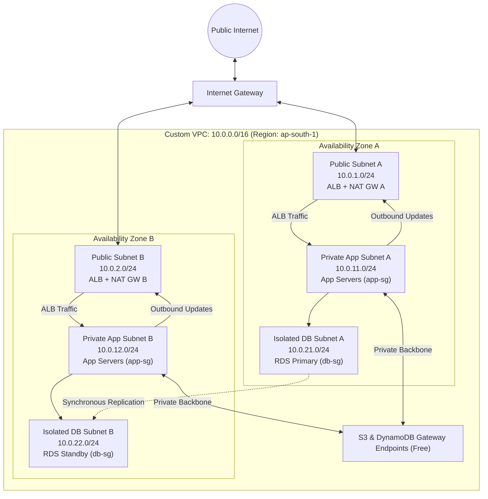
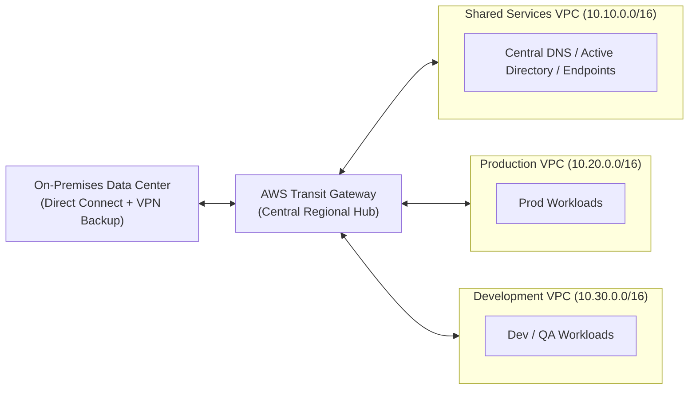

# AWS VPC (Virtual Private Cloud) — Complete Guide (Basics → Enterprise → Interview)

> Comprehensive, student-friendly reference covering IP addressing & CIDR basics, VPC core building blocks, routing, Security Groups vs. NACLs, NAT & VPC Endpoints, Peering vs. Transit Gateway, Hybrid connectivity, architecture diagrams, end-to-end AWS CLI labs, and interview Q&A.

---

## Table of Contents
1. What is Amazon VPC? (The Simple Mental Model)
2. IP Addressing & CIDR Subnetting Made Easy
3. Core VPC Building Blocks
4. Public vs. Private Subnets & Routing Tables
5. Internet Access: Internet Gateway (IGW) vs. NAT Gateway vs. Egress-Only IGW
6. VPC Security: Security Groups vs. Network ACLs (NACLs)
7. Private AWS Service Access: VPC Endpoints (Gateway vs. Interface)
8. Connecting Multiple VPCs: VPC Peering vs. AWS Transit Gateway
9. Hybrid Cloud Connectivity: Site-to-Site VPN & AWS Direct Connect
10. VPC Observability & Troubleshooting (Flow Logs & Reachability Analyzer)
11. Enterprise Reference Architectures & Diagrams
12. Industry Use Cases
13. Common Mistakes & Real-World Incidents
14. Complete Hands-on Practical Labs (All AWS CLI Commands)
15. Interview Questions & Answers (Top Scenarios)
16. One-Page Cheat Sheet
17. Suggested Teaching Session Flow

---

## 1. What is Amazon VPC? (The Simple Mental Model)

**Amazon Virtual Private Cloud (VPC)** is your own **private, logically isolated virtual data center** inside the AWS Cloud. You have complete control over your virtual networking environment, including IP address ranges, subnets, route tables, and network gateways.

### The Real-World Analogy (For Students)
Think of **AWS Cloud** as a massive city:
* **Region** = The city itself (e.g., Mumbai `ap-south-1`).
* **VPC** = A gated apartment complex you own inside that city, with a boundary wall around it.
* **Subnets** = Individual buildings/towers inside your complex (some open to visitors at the front gate = *Public Subnets*; some strictly for residents only = *Private Subnets*).
* **Route Tables** = The directional signboards telling traffic where to go (to another building, to the main gate, or nowhere).
* **Internet Gateway (IGW)** = The main front gate connecting your complex to the public city highway (the Internet).
* **Security Group** = The personal bodyguard standing right outside each apartment door (remembers who you let out so they can come back in = *Stateful*).
* **Network ACL (NACL)** = The security checkpoint at the entrance of each building/tower (checks every single person entering and leaving every time = *Stateless*).

### Key Characteristics
* **Regional resource**: A VPC lives in **one AWS Region**, spanning **all Availability Zones (AZs)** in that Region.
* **Subnets are AZ-specific**: Every subnet lives inside **one single Availability Zone**.
* **Default VPC vs. Custom VPC**: Every AWS account comes with a Default VPC per Region so beginners can launch EC2 instances immediately. In production, you **always build Custom VPCs** for proper isolation and IP planning.

---

## 2. IP Addressing & CIDR Subnetting Made Easy

Before touching AWS, students must understand **CIDR (Classless Inter-Domain Routing)** notation (`x.x.x.x/prefix`).

### How IPv4 Works
* An IPv4 address has **32 bits**, written as four numbers (`0–255`) separated by dots (each number = 8 bits).
* The `/prefix` (e.g., `/16` or `/24`) tells you **how many bits are locked (Network ID)** from the left. The remaining bits (`32 - prefix`) are free for host IP addresses.
* **Formula**: $\text{Total IPs} = 2^{(32 - \text{prefix})}$

| CIDR Block | Locked Bits | Host Bits | Total IP Addresses | AWS Usable IPs ($\text{Total} - 5$) | Typical Use |
|---|---|---|---|---|---|
| `/16` | 16 | 16 | $2^{16} = 65,536$ | $65,531$ | Entire VPC CIDR (e.g., `10.0.0.0/16`) |
| `/20` | 20 | 12 | $2^{12} = 4,096$ | $4,091$ | Large subnet / EKS worker nodes |
| `/24` | 24 | 8 | $2^{8} = 256$ | $251$ | Standard Subnet (e.g., `10.0.1.0/24`) |
| `/26` | 26 | 6 | $2^{6} = 64$ | $59$ | Small isolated subnet |
| `/28` | 28 | 4 | $2^{4} = 16$ | $11$ | Smallest subnet AWS allows! |

### AWS VPC CIDR Limits & Reserved IPs
* **Allowed VPC CIDR size**: Between **`/16`** ($65,536$ IPs) and **`/28`** ($16$ IPs).
* **Recommended Private IP Ranges (RFC 1918)**:
  * `10.0.0.0/8` (`10.0.0.0 – 10.255.255.255`) — Most popular in enterprise AWS environments.
  * `172.16.0.0/12` (`172.16.0.0 – 172.31.255.255`) — Used by Default VPCs (`172.31.0.0/16`).
  * `192.168.0.0/16` (`192.168.0.0 – 192.168.255.255`) — Common in home/small office networks.
* **CRITICAL INTERVIEW FACT — AWS Reserves 5 IP Addresses in EVERY Subnet**:
  For example, in subnet `10.0.1.0/24`:
  1. `10.0.1.0` — Network address
  2. `10.0.1.1` — Reserved by AWS for the **VPC Router**
  3. `10.0.1.2` — Reserved by AWS for **Amazon DNS Server** (always VPC base IP + 2)
  4. `10.0.1.3` — Reserved by AWS for future use
  5. `10.0.1.255` — Network broadcast address (AWS does not support broadcast, but reserves the IP)

> **Golden Rule of Enterprise IP Planning**: Never use overlapping CIDR blocks across VPCs or on-premises networks (e.g., don't make every VPC `10.0.0.0/16`), because you cannot peer or connect two networks with overlapping IPs!

---

## 3. Core VPC Building Blocks

| Component | Scope | What It Does |
|---|---|---|
| **VPC** | Region | Top-level isolated virtual network with up to 5 IPv4 CIDR blocks |
| **Subnet** | Single AZ | Sub-division of VPC IP range where AWS resources (EC2, RDS, ALB, ENI) are launched |
| **Route Table** | VPC / Subnet | Set of routing rules (`Destination → Target`) determining where network traffic is directed |
| **Internet Gateway (IGW)** | VPC | Horizontally scaled, redundant gateway enabling bidirectional Internet connectivity for public subnets |
| **NAT Gateway** | Single AZ | Allows instances in **private subnets** to initiate outbound internet traffic (OS updates, external APIs) while blocking unsolicited inbound connections |
| **Elastic IP (EIP)** | Region | Static, public IPv4 address allocated to your account (required for NAT Gateways) |
| **Security Group (SG)** | ENI / Instance | **Stateful**, instance-level virtual firewall supporting **Allow rules only** |
| **Network ACL (NACL)** | Subnet | **Stateless**, subnet-level firewall supporting both **Allow and Deny rules** evaluated in numbered order |
| **ENI (Elastic Network Interface)** | Subnet (AZ) | Virtual network card attached to EC2/services carrying private IPs, public IPs, MAC address, and SGs |

---

## 4. Public vs. Private Subnets & Routing Tables

There is **no checkbox** in AWS that says "Make this a Public Subnet." What makes a subnet public or private is **its Route Table**:

* **Public Subnet**: Associated with a Route Table that has a default route (`0.0.0.0/0`) pointing to an **Internet Gateway (`igw-xxxx`)** (plus resources usually have public IPs or sit behind a public Load Balancer).
* **Private Subnet**: Associated with a Route Table that **does NOT** have a route to an Internet Gateway. Outbound internet access (if needed) goes through a **NAT Gateway (`nat-xxxx`)**.
* **Isolated (Data) Subnet**: Associated with a Route Table that has **only the `local` route**—zero internet access in or out (ideal for RDS databases and ElastiCache).

### How Route Tables Evaluate Rules
1. Every Route Table automatically contains a **`local` route** (e.g., `10.0.0.0/16 → local`) that cannot be deleted. This allows all subnets inside the VPC to talk to each other automatically.
2. **Longest Prefix Match Wins**: If two routes match a destination IP, AWS picks the **most specific route** (highest `/prefix` number). For example, `10.1.0.0/16 → pcx-123` beats `0.0.0.0/0 → igw-456`.

### Sample Route Tables

**Public Subnet Route Table (`rtb-public`):**
| Destination | Target | Purpose |
|---|---|---|
| `10.0.0.0/16` | `local` | Internal VPC communication |
| `0.0.0.0/0` | `igw-0a1b2c3d` | Direct internet access via IGW |

**Private App Subnet Route Table (`rtb-private-az1`):**
| Destination | Target | Purpose |
|---|---|---|
| `10.0.0.0/16` | `local` | Internal VPC communication |
| `0.0.0.0/0` | `nat-09876543` | Outbound-only internet via NAT Gateway in AZ1 |

---

## 5. Internet Access: IGW vs. NAT Gateway vs. Egress-Only IGW

| Feature | Internet Gateway (IGW) | NAT Gateway | Egress-Only IGW |
|---|---|---|---|
| **IP Version** | IPv4 & IPv6 | IPv4 | **IPv6 only** |
| **Traffic Direction** | Inbound & Outbound | **Outbound-initiated only** | **Outbound-initiated only** |
| **Where It Lives** | Attached to the VPC | Launched inside a **Public Subnet** with an Elastic IP | Attached to the VPC |
| **High Availability** | Managed & redundant across all AZs automatically | **Single-AZ resource** — deploy 1 NAT Gateway per AZ for HA | Managed & redundant across all AZs |
| **Cost** | **Free** | Hourly charge + **per-GB data processing fee** | **Free** |

> **Why not NAT Instances?** Legacy EC2-based NAT Instances require manual patching, scaling, and source/destination check disabling. Always use managed **NAT Gateways** in production unless running a tiny dev lab to save cost.

---

## 6. VPC Security: Security Groups vs. Network ACLs (NACLs)

This is **the #1 most asked VPC interview comparison**:

| Dimension | Security Group (SG) | Network ACL (NACL) |
|---|---|---|
| **Operates At** | **Instance / ENI level** | **Subnet level** (affects all resources in the subnet) |
| **Statefulness** | **Stateful** — Return traffic is automatically allowed regardless of rules | **Stateless** — Return traffic must be explicitly allowed in inbound/outbound rules (including ephemeral ports `1024–65535`) |
| **Rule Types** | **Allow rules only** (implicit Deny at the end) | **Both Allow and Deny rules** |
| **Rule Evaluation** | Evaluates **all rules** together before deciding | Evaluates rules **in ascending numeric order** (`100`, `200`, `*`); stops at the first match |
| **Default Behavior** | Default SG allows all outbound; denies all inbound | Default NACL allows all inbound & outbound; Custom NACL denies all inbound & outbound |
| **Chaining / Referencing** | Can reference **another Security Group ID** (`sg-xxxx`) as source/destination! | Can only reference **CIDR IP blocks** (cannot reference SGs) |

### Tiered Security Group Chaining Pattern (Best Practice)
Instead of hardcoding IP addresses, reference Security Group IDs:
1. **`alb-sg`**: Allows inbound TCP `80`/`443` from `0.0.0.0/0`.
2. **`app-sg`**: Allows inbound TCP `8080` **only from `alb-sg`**.
3. **`db-sg`**: Allows inbound TCP `5432` (PostgreSQL) **only from `app-sg`**.

---

## 7. Private AWS Service Access: VPC Endpoints

Without VPC Endpoints, when an EC2 instance in a private subnet accesses **Amazon S3** or **DynamoDB**, traffic travels through your **NAT Gateway** and over the public internet—incurring NAT per-GB processing charges.

**VPC Endpoints** keep traffic 100% inside the private AWS backbone network:

| Feature | Gateway VPC Endpoint | Interface VPC Endpoint (AWS PrivateLink) |
|---|---|---|
| **Supported Services** | **Only Amazon S3 and DynamoDB** | **100+ AWS services** (SQS, SNS, KMS, Secrets Manager, ECR, STS, CloudWatch, etc.) + SaaS/partner services |
| **How It Works** | Adds a prefix-list route (`pl-xxxx`) to your VPC **Route Table** | Creates an **Elastic Network Interface (ENI)** with a private IP inside your subnet |
| **Security Control** | VPC Endpoint Policy + Bucket/Table Policy | **Security Group attached to ENI** + VPC Endpoint Policy |
| **Cost** | **Completely FREE** | Hourly ENI cost per AZ + per-GB data processing fee |
| **On-Prem Reachability** | **No** (VPC-local only) | **Yes** (accessible from on-premises over Direct Connect / VPN) |

---

## 8. Connecting Multiple VPCs: Peering vs. Transit Gateway

### VPC Peering
* Direct **1-to-1 private network connection** between two VPCs (same account, cross-account, or cross-Region).
* **CRITICAL RULE — Non-Transitive**: If VPC A is peered with VPC B, and VPC B is peered with VPC C, **VPC A CANNOT talk to VPC C** through VPC B. You must create a direct peering connection between A and C (leading to a messy $N(N-1)/2$ full-mesh problem at scale).
* **CIDR blocks must not overlap**.
* You must manually update Route Tables on **both sides** of the peering connection.

### AWS Transit Gateway (TGW)
* A **centralized regional cloud router (hub-and-spoke)** connecting hundreds/thousands of VPCs, VPNs, and Direct Connect gateways.
* **Transitive routing supported**: Spokes communicate through the central Transit Gateway hub, controlled via TGW Route Tables (network segmentation).
* Eliminates complex full-mesh peering architectures at enterprise scale.

---

## 9. Hybrid Cloud Connectivity: VPN vs. Direct Connect

| Feature | AWS Site-to-Site VPN | AWS Direct Connect (DX) |
|---|---|---|
| **Transport Medium** | Encrypted IPsec tunnels over the **public Internet** | **Dedicated private fiber-optic link** from your data center to an AWS DX location |
| **Setup Time** | **Minutes** | **Weeks to months** (physical circuit provisioning) |
| **Bandwidth & Latency** | Up to ~1.25 Gbps per tunnel; variable internet latency | **1 Gbps, 10 Gbps, or 100 Gbps**; consistent, predictable low latency |
| **Encryption in Transit** | **Encrypted by default** (IPsec) | **Not encrypted by default** (use MACsec or run Site-to-Site VPN over DX for IPsec encryption) |
| **Best Use Case** | Fast setup, backup/failover link, moderate bandwidth | High-throughput enterprise workloads, strict latency/compliance SLAs |

---

## 10. VPC Observability & Troubleshooting

* **VPC Flow Logs**: Captures metadata about IP traffic going to and from network interfaces (at VPC, Subnet, or ENI level). Published to **CloudWatch Logs**, **Amazon S3**, or **Data Firehose**.
  * *Shows*: Source/Dest IP, Ports, Protocol, Packets/Bytes, and `ACCEPT` or `REJECT`.
  * *Does NOT show*: Packet payload contents, DNS traffic to Amazon DNS (`169.254.169.253`), or EC2 instance metadata (`169.254.169.254`).
* **VPC Reachability Analyzer**: Static configuration analysis tool that traces the exact hop-by-hop path between two resources (e.g., ALB $\rightarrow$ EC2 $\rightarrow$ RDS) and pinpoints the exact Security Group, NACL, or Route Table blocking traffic—**without sending actual packets**.
* **Traffic Mirroring**: Copies actual packet payloads from an ENI to security/IDS appliances for deep packet inspection.

---

## 11. Enterprise Reference Architectures & Diagrams

### 11.1 Production 3-Tier Multi-AZ VPC Architecture
High-availability layout across 2 Availability Zones separating Public (ALB/NAT), Private App (EC2/ECS/EKS), and Isolated Data (RDS/ElastiCache) tiers.



### 11.2 Enterprise Hub-and-Spoke Network with AWS Transit Gateway
Connects Shared Services, Production, Development, and On-Premises data centers without full-mesh peering complexity.



---

## 12. Industry Use Cases

| Industry | VPC Architecture Pattern | Key VPC Features Used |
|---|---|---|
| **Banking & FinTech** | Strict PCI-DSS network segmentation isolating cardholder data environments (CDE) from general corporate apps | Isolated subnets, NACLs + SGs, Transit Gateway route isolation, VPC Flow Logs |
| **Healthcare / SaaS** | Multi-tenant SaaS exposing private APIs to enterprise customers without opening public endpoints | AWS PrivateLink (Interface VPC Endpoints), private NLBs |
| **Hybrid Enterprise** | Extending on-premises ERP/mainframes into AWS with deterministic low latency | AWS Direct Connect + Site-to-Site VPN failover + Transit Gateway |
| **Big Data & AI/ML** | High-throughput private data transfer between compute clusters and S3 data lakes | Gateway VPC Endpoints for S3 (zero NAT cost), multi-AZ high-bandwidth subnets |

---

## 13. Common Mistakes & Real-World Incidents

1. **Overlapping CIDR blocks across VPCs**: Creating every VPC with `10.0.0.0/16` blocks future VPC Peering, Transit Gateway routing, and VPN connections. Always maintain a central IPAM (IP Address Management) plan.
2. **Single NAT Gateway in Production**: Placing only one NAT Gateway in AZ-A means if AZ-A suffers an outage, private instances in AZ-B also lose outbound internet access (and cross-AZ data transfer fees apply). Deploy one NAT Gateway per AZ.
3. **Forgetting Ephemeral Ports (`1024–65535`) on Custom NACLs**: Because NACLs are stateless, blocking ephemeral ports on outbound/inbound rules breaks return TCP responses even when port 80/443 is allowed.
4. **Massive surprise NAT Gateway bills**: Pulling/pushing terabytes to S3 or ECR from private subnets without VPC Endpoints incurs $0.045/GB in NAT processing charges.
5. **Enabling `Auto-assign public IPv4` on Private Subnets**: Even if an instance gets a public IP, it still cannot reach the internet unless its subnet's Route Table has a route to an Internet Gateway.

---

## 14. Complete Hands-on Practical Labs (All AWS CLI Commands)

Every lab below is copy-pasteable and builds a complete production-style VPC from scratch using **AWS CLI v2**.

### Lab 0: Set Environment Variables
```bash
export AWS_REGION="ap-south-1"
export AZ1="${AWS_REGION}a"
export AZ2="${AWS_REGION}b"
```

---

### Lab 1: Build a Custom VPC with Public & Private Subnets (Multi-AZ)
```bash
# 1. Create Custom VPC (10.0.0.0/16) with DNS hostnames & resolution enabled
VPC_ID=$(aws ec2 create-vpc \
  --cidr-block 10.0.0.0/16 \
  --tag-specifications 'ResourceType=vpc,Tags=[{Key=Name,Value=Prod-Custom-VPC}]' \
  --query 'Vpc.VpcId' --output text)

aws ec2 modify-vpc-attribute --vpc-id "$VPC_ID" --enable-dns-support '{"Value":true}'
aws ec2 modify-vpc-attribute --vpc-id "$VPC_ID" --enable-dns-hostnames '{"Value":true}'
echo "VPC Created: $VPC_ID"

# 2. Create 2 Public Subnets & 2 Private Subnets across 2 Availability Zones
PUB_SUB1=$(aws ec2 create-subnet --vpc-id "$VPC_ID" --cidr-block 10.0.1.0/24 --availability-zone "$AZ1" \
  --tag-specifications 'ResourceType=subnet,Tags=[{Key=Name,Value=Public-Subnet-AZ1}]' \
  --query 'Subnet.SubnetId' --output text)

PUB_SUB2=$(aws ec2 create-subnet --vpc-id "$VPC_ID" --cidr-block 10.0.2.0/24 --availability-zone "$AZ2" \
  --tag-specifications 'ResourceType=subnet,Tags=[{Key=Name,Value=Public-Subnet-AZ2}]' \
  --query 'Subnet.SubnetId' --output text)

PRIV_SUB1=$(aws ec2 create-subnet --vpc-id "$VPC_ID" --cidr-block 10.0.11.0/24 --availability-zone "$AZ1" \
  --tag-specifications 'ResourceType=subnet,Tags=[{Key=Name,Value=Private-Subnet-AZ1}]' \
  --query 'Subnet.SubnetId' --output text)

PRIV_SUB2=$(aws ec2 create-subnet --vpc-id "$VPC_ID" --cidr-block 10.0.12.0/24 --availability-zone "$AZ2" \
  --tag-specifications 'ResourceType=subnet,Tags=[{Key=Name,Value=Private-Subnet-AZ2}]' \
  --query 'Subnet.SubnetId' --output text)

# Enable auto-assign public IP on Public Subnets
aws ec2 modify-subnet-attribute --subnet-id "$PUB_SUB1" --map-public-ip-on-launch
aws ec2 modify-subnet-attribute --subnet-id "$PUB_SUB2" --map-public-ip-on-launch
```

---

### Lab 2: Configure Internet Gateway, NAT Gateway & Route Tables
```bash
# 1. Create & Attach Internet Gateway (IGW)
IGW_ID=$(aws ec2 create-internet-gateway \
  --tag-specifications 'ResourceType=internet-gateway,Tags=[{Key=Name,Value=Prod-IGW}]' \
  --query 'InternetGateway.InternetGatewayId' --output text)

aws ec2 attach-internet-gateway --vpc-id "$VPC_ID" --internet-gateway-id "$IGW_ID"

# 2. Create Public Route Table & add 0.0.0.0/0 -> IGW
PUB_RTB=$(aws ec2 create-route-table --vpc-id "$VPC_ID" \
  --tag-specifications 'ResourceType=route-table,Tags=[{Key=Name,Value=Public-RTB}]' \
  --query 'RouteTable.RouteTableId' --output text)

aws ec2 create-route --route-table-id "$PUB_RTB" --destination-cidr-block 0.0.0.0/0 --gateway-id "$IGW_ID"
aws ec2 associate-route-table --subnet-id "$PUB_SUB1" --route-table-id "$PUB_RTB"
aws ec2 associate-route-table --subnet-id "$PUB_SUB2" --route-table-id "$PUB_RTB"

# 3. Allocate Elastic IP & Create NAT Gateway in Public Subnet AZ1
EIP_ALLOC=$(aws ec2 allocate-address --domain vpc --query 'AllocationId' --output text)

NAT_ID=$(aws ec2 create-nat-gateway \
  --subnet-id "$PUB_SUB1" \
  --allocation-id "$EIP_ALLOC" \
  --tag-specifications 'ResourceType=natgateway,Tags=[{Key=Name,Value=Prod-NAT-AZ1}]' \
  --query 'NatGateway.NatGatewayId' --output text)

echo "Waiting for NAT Gateway $NAT_ID to become available..."
aws ec2 wait nat-gateway-available --nat-gateway-ids "$NAT_ID"

# 4. Create Private Route Table & add 0.0.0.0/0 -> NAT Gateway
PRIV_RTB=$(aws ec2 create-route-table --vpc-id "$VPC_ID" \
  --tag-specifications 'ResourceType=route-table,Tags=[{Key=Name,Value=Private-RTB}]' \
  --query 'RouteTable.RouteTableId' --output text)

aws ec2 create-route --route-table-id "$PRIV_RTB" --destination-cidr-block 0.0.0.0/0 --nat-gateway-id "$NAT_ID"
aws ec2 associate-route-table --subnet-id "$PRIV_SUB1" --route-table-id "$PRIV_RTB"
aws ec2 associate-route-table --subnet-id "$PRIV_SUB2" --route-table-id "$PRIV_RTB"
```

---

### Lab 3: Tiered Security Groups (SG Chaining) & Custom NACL
```bash
# 1. Create Web/ALB Security Group (allows HTTP/HTTPS from Internet)
WEB_SG=$(aws ec2 create-security-group \
  --group-name "web-tier-sg" \
  --description "Allow HTTP/HTTPS from Internet" \
  --vpc-id "$VPC_ID" \
  --query 'GroupId' --output text)

aws ec2 authorize-security-group-ingress --group-id "$WEB_SG" --protocol tcp --port 80 --cidr 0.0.0.0/0
aws ec2 authorize-security-group-ingress --group-id "$WEB_SG" --protocol tcp --port 443 --cidr 0.0.0.0/0

# 2. Create App Security Group (allows port 8080 ONLY from web-tier-sg!)
APP_SG=$(aws ec2 create-security-group \
  --group-name "app-tier-sg" \
  --description "Allow port 8080 only from Web SG" \
  --vpc-id "$VPC_ID" \
  --query 'GroupId' --output text)

aws ec2 authorize-security-group-ingress --group-id "$APP_SG" --protocol tcp --port 8080 --source-group "$WEB_SG"

# 3. Create Custom NACL with explicit Deny rule + Stateless Ephemeral Port Return Rule
NACL_ID=$(aws ec2 create-network-acl --vpc-id "$VPC_ID" \
  --tag-specifications 'ResourceType=network-acl,Tags=[{Key=Name,Value=Custom-Public-NACL}]' \
  --query 'NetworkAcl.NetworkAclId' --output text)

# Rule 50: Block a malicious IP (lower rule number evaluates first!)
aws ec2 create-network-acl-entry --network-acl-id "$NACL_ID" --ingress --rule-number 50 \
  --protocol -1 --rule-action deny --cidr-block 203.0.113.50/32

# Rule 100: Allow Inbound HTTP (80) & Ephemeral return ports (1024-65535)
aws ec2 create-network-acl-entry --network-acl-id "$NACL_ID" --ingress --rule-number 100 \
  --protocol tcp --port-range From=80,To=80 --rule-action allow --cidr-block 0.0.0.0/0
aws ec2 create-network-acl-entry --network-acl-id "$NACL_ID" --ingress --rule-number 110 \
  --protocol tcp --port-range From=1024,To=65535 --rule-action allow --cidr-block 0.0.0.0/0

# Outbound Rules: Allow all outbound traffic
aws ec2 create-network-acl-entry --network-acl-id "$NACL_ID" --egress --rule-number 100 \
  --protocol -1 --rule-action allow --cidr-block 0.0.0.0/0
```

---

### Lab 4: Create Free S3 Gateway VPC Endpoint & Enable VPC Flow Logs
```bash
# 1. Create Gateway VPC Endpoint for S3 attached to Private Route Table
VPCE_S3=$(aws ec2 create-vpc-endpoint \
  --vpc-id "$VPC_ID" \
  --vpc-endpoint-type Gateway \
  --service-name "com.amazonaws.${AWS_REGION}.s3" \
  --route-table-ids "$PRIV_RTB" \
  --query 'VpcEndpoint.VpcEndpointId' --output text)
echo "S3 Gateway Endpoint Created: $VPCE_S3"

# Inspect updated Private Route Table (notice pl-xxxx route added automatically!)
aws ec2 describe-route-tables --route-table-ids "$PRIV_RTB" --query 'RouteTables[0].Routes'

# 2. Enable VPC Flow Logs (to CloudWatch Logs)
aws logs create-log-group --log-group-name "/aws/vpc/prod-custom-vpc-flowlogs"
```

---

### Lab 5: VPC Peering Setup & Cleanup Script
```bash
# 1. Create a second VPC (10.1.0.0/16) and peer it with Prod-Custom-VPC (10.0.0.0/16)
VPC_PEER_TARGET=$(aws ec2 create-vpc \
  --cidr-block 10.1.0.0/16 \
  --tag-specifications 'ResourceType=vpc,Tags=[{Key=Name,Value=Analytics-VPC}]' \
  --query 'Vpc.VpcId' --output text)

PCX_ID=$(aws ec2 create-vpc-peering-connection \
  --vpc-id "$VPC_ID" \
  --peer-vpc-id "$VPC_PEER_TARGET" \
  --query 'VpcPeeringConnection.VpcPeeringConnectionId' --output text)

aws ec2 accept-vpc-peering-connection --vpc-peering-connection-id "$PCX_ID"

# Add route in Private Route Table pointing 10.1.0.0/16 -> Peering Connection
aws ec2 create-route --route-table-id "$PRIV_RTB" --destination-cidr-block 10.1.0.0/16 --vpc-peering-connection-id "$PCX_ID"

# 2. Cleanup Lab Resources (Delete in reverse dependency order)
aws ec2 delete-vpc-peering-connection --vpc-peering-connection-id "$PCX_ID"
aws ec2 delete-vpc --vpc-id "$VPC_PEER_TARGET"
aws ec2 delete-vpc-endpoints --vpc-endpoint-ids "$VPCE_S3"
aws ec2 delete-nat-gateway --nat-gateway-id "$NAT_ID"
aws ec2 wait nat-gateway-deleted --nat-gateway-ids "$NAT_ID"
aws ec2 release-address --allocation-id "$EIP_ALLOC"
aws ec2 detach-internet-gateway --internet-gateway-id "$IGW_ID" --vpc-id "$VPC_ID"
aws ec2 delete-internet-gateway --internet-gateway-id "$IGW_ID"
aws ec2 delete-security-group --group-id "$APP_SG"
aws ec2 delete-security-group --group-id "$WEB_SG"
aws ec2 delete-network-acl --network-acl-id "$NACL_ID"
aws ec2 delete-subnet --subnet-id "$PUB_SUB1"
aws ec2 delete-subnet --subnet-id "$PUB_SUB2"
aws ec2 delete-subnet --subnet-id "$PRIV_SUB1"
aws ec2 delete-subnet --subnet-id "$PRIV_SUB2"
aws ec2 delete-route-table --route-table-id "$PUB_RTB"
aws ec2 delete-route-table --route-table-id "$PRIV_RTB"
aws ec2 delete-vpc --vpc-id "$VPC_ID"
```

---

## 15. Interview Questions & Answers (Top Scenarios)

**Q1. What makes a subnet "Public" vs. "Private" in AWS?**
A subnet is **Public** if its associated Route Table contains a route (`0.0.0.0/0`) to an **Internet Gateway (`igw-xxxx`)**. A subnet is **Private** if it has no route to an IGW (outbound internet traffic goes through a NAT Gateway instead).

**Q2. How many IP addresses does AWS reserve in every subnet, and what are they for?**
AWS reserves **5 IP addresses** in every subnet: `.0` (Network address), `.1` (VPC Router), `.2` (Amazon DNS Server), `.3` (Future use), and `.255` (Broadcast address in a `/24`).

**Q3. Security Group vs. Network ACL — what are the core differences?**
Security Groups operate at the **instance/ENI level**, are **stateful**, support **Allow rules only**, and can reference other Security Groups. NACLs operate at the **subnet level**, are **stateless** (requiring explicit ephemeral port rules for return traffic), support **Allow and Deny rules**, and evaluate rules in **numbered order**.

**Q4. Can you block a specific malicious IP address using a Security Group?**
No—Security Groups only support `Allow` rules. To explicitly deny a specific IP or CIDR block, use a **Network ACL (NACL)** with a lower-numbered `DENY` rule (or AWS WAF at the ALB/CloudFront layer).

**Q5. Why is VPC Peering non-transitive, and how do you solve it at enterprise scale?**
VPC Peering only allows traffic between the two directly peered VPCs (`A ↔ B` and `B ↔ C` does not allow `A ↔ C`). At enterprise scale, replace full-mesh peering with **AWS Transit Gateway**, which acts as a transitive hub-and-spoke router.

**Q6. Private EC2 instances are downloading large datasets from S3, causing a massive NAT Gateway bill. How do you fix this?**
Create a **Gateway VPC Endpoint for S3** (which is completely free) and associate it with the private subnets' Route Tables. S3 traffic will route privately over the AWS backbone instead of through the NAT Gateway.

**Q7. What happens if a NAT Gateway's Availability Zone goes down?**
Because a NAT Gateway is a **single-AZ resource**, all private subnets routing through it lose outbound internet access. Production architectures deploy **one NAT Gateway per Availability Zone** with separate per-AZ private Route Tables.

**Q8. An EC2 instance in a public subnet has a Public IP, an IGW is attached to the VPC, and Security Group allows port 80—yet `curl` times out. What do you check?**
1. Does the subnet's **Route Table** have `0.0.0.0/0 → igw-xxxx`?
2. Does the **NACL** allow both inbound port 80 AND outbound ephemeral ports (`1024–65535`)?
3. Is the web server actually running and listening on `0.0.0.0:80` (not `127.0.0.1`)?
4. Run **VPC Reachability Analyzer** to pinpoint the exact blocked hop.

**Q9. Gateway VPC Endpoint vs. Interface VPC Endpoint?**
Gateway Endpoints support **only S3 and DynamoDB**, modify **Route Tables**, and are **free**. Interface Endpoints (AWS PrivateLink) support **100+ AWS services**, create an **ENI with a private IP** secured by a Security Group, cost hourly + per-GB, and are reachable from **on-premises** over Direct Connect/VPN.

**Q10. Is AWS Direct Connect encrypted by default?**
No. Unlike Site-to-Site VPN (which uses IPsec encryption), Direct Connect is a dedicated private physical link without built-in IP encryption. To encrypt traffic over Direct Connect, use **MACsec** (Layer 2) or run an **AWS Site-to-Site VPN** tunnel over a Public VIF (Layer 3).

---

## 16. One-Page Cheat Sheet

```text
VPC SCOPE:  Regional resource (spans all AZs) | Subnets = Single AZ | CIDR: /16 (65,536) to /28 (16)
RESERVED:   5 IPs per subnet (.0 Network, .1 Router, .2 DNS, .3 Future, .255 Broadcast)
ROUTING:    Longest prefix match wins | Public Subnet = Route to IGW | Private Subnet = Route to NAT GW
GATEWAYS:   IGW = Free, HA, IPv4+IPv6 | NAT GW = Single-AZ, Paid, Public Subnet + EIP | Egress-Only IGW = IPv6
FIREWALLS:  Security Group = Instance/ENI, Stateful, Allow-only, SG chaining
            NACL = Subnet, Stateless (ephemeral ports 1024-65535!), Allow+Deny, Numbered order
ENDPOINTS:  Gateway VPCE = S3 & DynamoDB ONLY, Route Table, FREE
            Interface VPCE (PrivateLink) = 100+ services, ENI + Private IP + SG, Paid, On-prem reachable
MULTI-VPC:  VPC Peering = 1-to-1, Non-transitive, No overlapping CIDRs | Transit Gateway = Transitive Hub-Spoke
HYBRID:     Site-to-Site VPN = Internet + IPsec encrypted (minutes) | Direct Connect = Dedicated fiber, unencrypted
DEBUGGING:  VPC Flow Logs (metadata ACCEPT/REJECT) | Reachability Analyzer (hop-by-hop static path check)
```

---

## 17. Suggested Teaching Session Flow (≈ 2.5–3 Hours)

| Time | Module | Teaching Aid / Demo |
|---|---|---|
| **0:00–0:20** | The Gated Community Analogy & CIDR Basics | **Slides 1–4**: Interactive IP/Subnet calculator exercise |
| **0:20–0:50** | VPC, Subnets, Route Tables, IGW vs. NAT GW | **Slides 5–7 + Lab 1 & 2**: Build custom VPC live in CLI |
| **0:50–1:25** | Security Groups vs. NACLs (Stateful vs. Stateless) | **Slides 8–9 + Lab 3**: SG chaining & NACL ephemeral port demo |
| **1:25–1:40** | *Break & Q&A* | — |
| **1:40–2:10** | VPC Endpoints, Peering vs. Transit Gateway & Hybrid | **Slides 10–12 + Lab 4 & 5**: Free S3 Endpoint & Peering |
| **2:10–2:35** | Flow Logs, Reachability Analyzer & Production Mistakes | **Slides 13–14**: Live troubleshooting scenarios |
| **2:35–3:00** | Rapid-Fire Interview Drills & Architecture Whiteboard | **Slide 15**: Student whiteboard challenge |